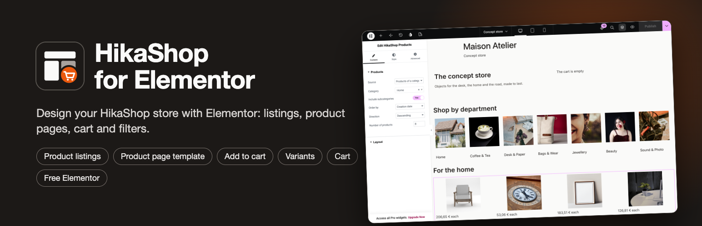
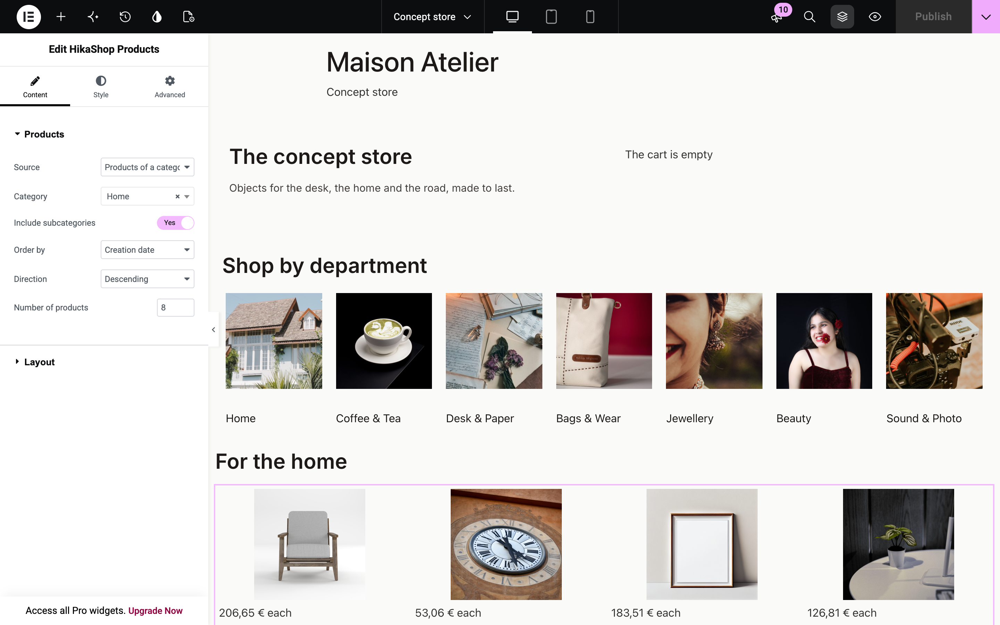
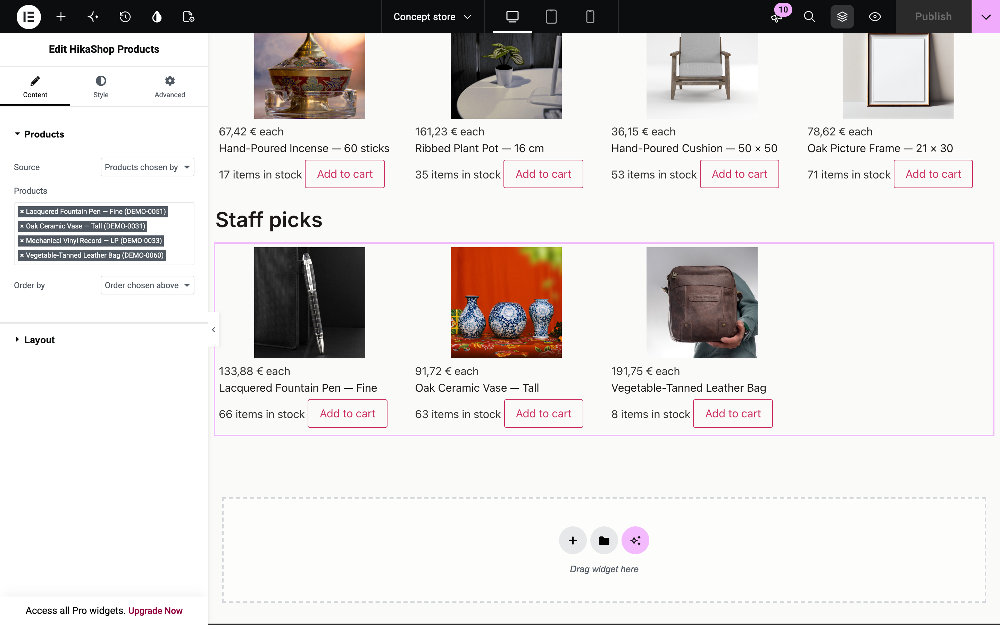
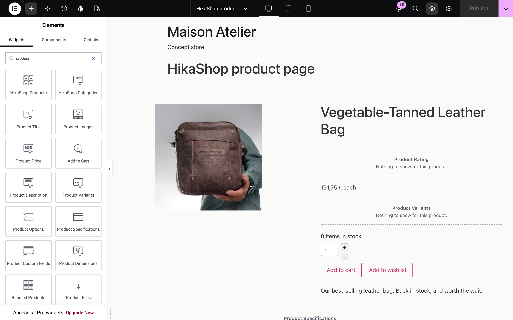
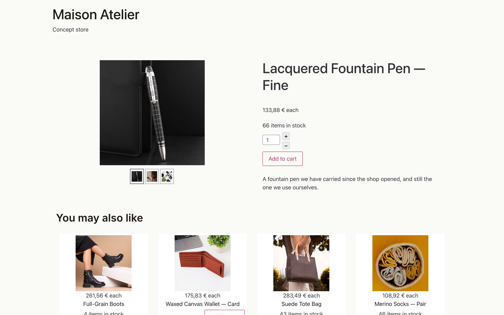
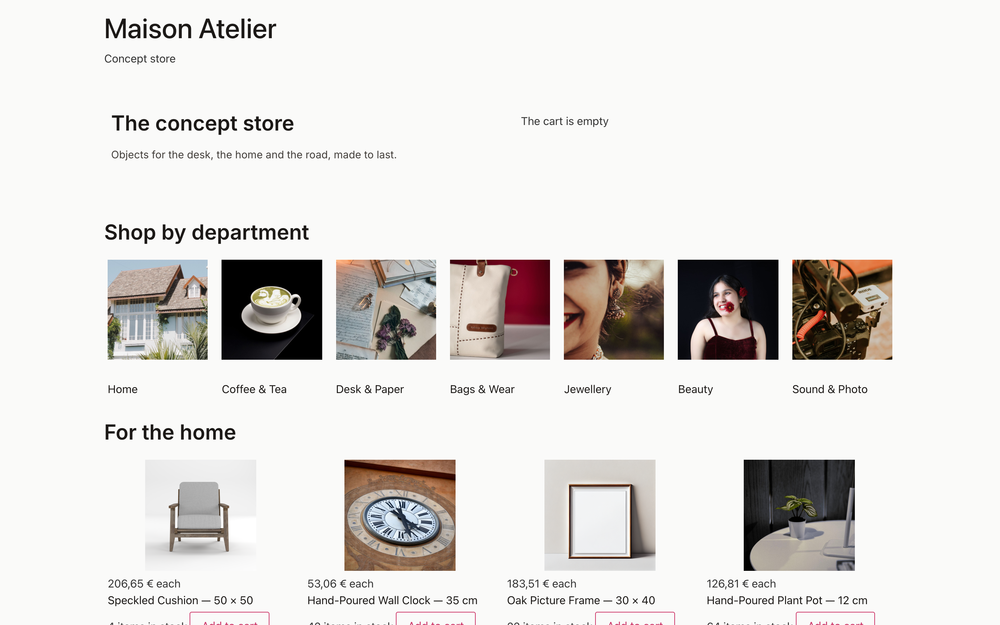
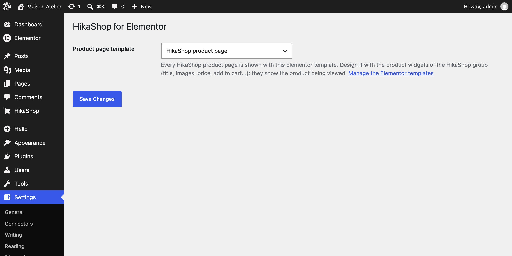

<p align="center">
  
</p>

<p align="center">
  <a href="https://github.com/hikashop-nicolas/hikashop-for-elementor/actions/workflows/ci.yml"></a>
  
  
  
  
</p>

# HikaShop for Elementor

Design a [HikaShop](https://www.hikashop.com) store with [Elementor](https://elementor.com). Product listings, category listings, every part of the product page, the cart, the wishlist, the currency switcher and the filters become Elementor widgets, and HikaShop product pages can be shown with an Elementor template.

It works with the **free Elementor**: nothing here needs Elementor Pro.



## What you get

| Widget | What it shows |
|---|---|
| **HikaShop Products** | Products of a category (with or without its subcategories), products chosen by hand, products on sale, the visitor's recently viewed products, or the products related to the product being viewed. Order, number, columns, product layout, and whether to show the price, add to cart, quantity, wishlist, rating and badges. |
| **HikaShop Categories** | The subcategories of a category, with their product counts, empty ones hidden if you want. |
| **Product Title, Images, Price, Add to Cart, Description, Variants, Options, Custom Fields, Specifications, Dimensions, Bundled Products, Files, Rating, Sharing** | One part each of the product being viewed, to place anywhere in the product page template. |
| **HikaShop Cart, Wishlist, Currency Switcher, Filters** | HikaShop's own modules, with their full settings one click away. |

Every widget has a style tab (colors, typography, alignment) on top of HikaShop's own CSS.

### Products chosen by hand

The product picker searches the HikaShop catalog by name, code or id, and keeps the order you give.



### Product pages designed in Elementor

Create a template in *Templates > Saved Templates*, lay out the product widgets, and pick it in *Settings > HikaShop for Elementor*. Every HikaShop product page is then shown with it. In the editor the latest product of the shop stands in, so you see real content while you design.



The variant selectors, the add to cart button, the image gallery and a link to a given variant (`?hikashop_char=`) behave as on HikaShop's own product page; unpublished products, products hidden from the visitor's user group or language still get HikaShop's own answer.



### A whole shop page



## Requirements

| | |
|---|---|
| WordPress | 6.6 or newer |
| PHP | 7.4 or newer |
| Elementor | 3.24 or newer, the free plugin is enough |
| HikaShop | 6.8.2 or newer on WordPress, a package downloaded since 12 November 2026 (Starter, the free edition, works: [download it](https://www.hikashop.com/download)) |

If a requirement is missing, the plugin stays inactive and says which one in the admin.

## Installation

1. Install and activate HikaShop and Elementor.
2. Install HikaShop for Elementor from *Plugins > Add New* (once it is on WordPress.org), or upload the zip of the [latest release](https://github.com/hikashop-nicolas/hikashop-for-elementor/releases).
3. Edit a page with Elementor and search the widget panel for "HikaShop".
4. For the product pages, design a template and choose it in *Settings > HikaShop for Elementor*.



## How it works

The plugin reimplements no shop logic, so prices, taxes, discounts, stock, access rights, the cart and the HikaShop layout overrides of your theme all apply as they do on HikaShop's own pages.

- **Listings** go through `hikashop_getLayout()` with module settings, the way HikaShop's own modules render.
- **Product parts** render HikaShop's product blocks (the ones of the WordPress site editor) for the product of the page.
- **Cart, wishlist, currency and filters** render HikaShop's WordPress widgets; their settings are stored by HikaShop under an id derived from the Elementor element.
- **The product page template** hooks the `hikashop_wp_page_output` filter of HikaShop.
- **The editor**: Elementor renders widgets inside admin requests; `hikashop_siteRendering()` makes HikaShop render as on the site there (frontend layouts, links and image paths).
- **Output** is escaped with `wp_kses()` and an allowlist for HikaShop's forms; HikaShop's inline scripts and styles go through `wp_add_inline_script()` and `wp_add_inline_style()`.

## Development

```sh
bin/build.sh    # build/hikashop-for-elementor/ and its zip, without the dev files
```

```
hikashop-for-elementor.php     bootstrap
includes/class-plugin.php      requirements, widget and control registration
includes/class-listing.php     product and category listings
includes/class-render.php      escaping, scripts and styles, site rendering scope
includes/class-product-template.php   product page template and its setting
includes/class-ajax.php        catalog search of the product picker
includes/controls/             the product picker control
includes/widgets/              the widgets
assets/                        editor script, frontend CSS
.wordpress-org/                WordPress.org icon, banners and screenshots
```

CI lints the PHP on 7.4, 8.1 and 8.4 and runs [Plugin Check](https://wordpress.org/plugins/plugin-check/) on the build: every category, experimental and low-severity checks included, in strict mode, so any error or warning fails the build. A release cannot be deployed without passing it.

## Release

1. Bump `Version` in `hikashop-for-elementor.php`, `HIKASHOP_ELEMENTOR_VERSION`, `Stable tag` in `readme.txt`, and add the changelog entry to `readme.txt`.
2. Tag the commit with the version (`1.0.1`) and push the tag. The deploy workflow checks the versions match, runs Plugin Check, commits the release and the `.wordpress-org/` assets to the WordPress.org SVN, and creates the GitHub release with the zip.

The SVN credentials are the `SVN_USERNAME` and `SVN_PASSWORD` repository secrets.

## Support

Questions and bug reports: [GitHub issues](https://github.com/hikashop-nicolas/hikashop-for-elementor/issues) or the [HikaShop forum](https://www.hikashop.com/forum).

## License

GPLv2 or later. Elementor is a trademark of its owner; this plugin is not made or endorsed by Elementor.
